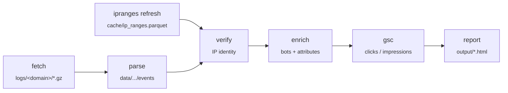

# logAnalyzer2

> nginx access-log analyzer that turns raw, rotated log archives into a single, self-contained, interactive HTML report — one report per site, many sites.

<p>
  
  
  
  
</p>

logAnalyzer2 reads the access logs an nginx server actually writes — millions of
rows, mostly bots and scanners — and answers the questions that matter for SEO and
operations: **who crawled what, when, how much, and was it really who it claimed
to be?** It verifies crawler identity (official IP ranges + reverse DNS),
classifies bots from declarative rules, folds in Google Search Console
clicks/impressions, and renders everything into a static HTML page whose data is
embedded and filterable in the browser — no server, no database at view time.

---

## Table of contents

- [Why](#why)
- [Features](#features)
- [How it works](#how-it-works)
- [Requirements](#requirements)
- [Installation](#installation)
- [Configuration](#configuration)
- [Usage](#usage)
- [Project layout](#project-layout)
- [The report](#the-report)
- [Design notes & known pitfalls](#design-notes--known-pitfalls)
- [Development](#development)
- [License](#license)

---

## Why

Off-the-shelf log tools assume the log tells the truth and that the first URL
segment is a "section". Real nginx logs don't cooperate:

- **Rotation numbering is not chronological.** With `logrotate size 100M` +
  `delaycompress`, `access.log.2` can cover an *older* period than `access.log.2.gz`.
  Ordering files by name produces a wrong timeline — order is always established
  from the **content**, never the filename.
- **Scanner traffic dominates.** Distinct first path segments run into the tens of
  thousands, almost all machine-generated. "Sections" must come from an allow-list.
- **User agents lie.** A scraper carrying a `Chrome/` token lands among human
  browsers unless you verify identity against the crawler owner's published ranges
  and reverse DNS.
- **Two servers can write the same log.** A two-tier vhost logs each request twice
  (edge IP over HTTP/2, then `127.0.0.1` over HTTP/1.1); behind a proxy the client
  IP may never appear at all.

logAnalyzer2 is built around these realities rather than in spite of them.

## Features

- **Incremental fetch over SSH** — pulls only the log files not already in the
  local archive; the local archive under `logs/<domain>/` is the source of truth
  (servers rotate history away).
- **Local source mode** — read logs from one or more directories on disk instead of
  SSH; file identity is the fingerprint of the *decompressed* content, so the same
  day delivered both plain and gzipped is not counted twice.
- **Format-driven parser** — the parser is generated from the site's nginx
  `log_format` string, not hard-coded.
- **Columnar storage** — logs become Parquet (Polars + PyArrow); every stage is
  idempotent and writes its own artifact.
- **Crawler identity verification** — matches client IPs against official bot IP
  ranges and confirms with reverse DNS; a definitive `NXDOMAIN` on the PTR is
  classified `SPOOFED`, not `DNS_ERROR`.
- **Declarative classification** — UA→category, IP-range sources and
  attack-probe rules all live in YAML, never in code.
- **Search Console enrichment** — optional click/impression data per page,
  degrades gracefully when unavailable.
- **Multi-site** — one YAML file per domain; global defaults are deep-merged
  under each site's overrides.
- **Self-contained report** — the aggregated data is embedded in the HTML
  (gzip+base64 by default); charts and tables can be inlined for a fully offline
  file.

## How it works

The pipeline is a chain of idempotent stages. Each has its own subcommand and
artifact, so re-running never starts from scratch; `run` executes them in order.



| Stage      | Input                          | Output                                   |
|------------|--------------------------------|------------------------------------------|
| `fetch`    | remote `access.log*` (SSH)     | `logs/<domain>/` archive + `_manifest.json` |
| `parse`    | `.gz`/`.log` archive           | `data/<domain>/events/` (Parquet)        |
| `ipranges` | official bot-range sources     | `cache/ip_ranges.parquet` (global)       |
| `verify`   | events + IP ranges + rDNS      | IP identity (`VERIFIED` / `SPOOFED` / …) |
| `enrich`   | verified events + `bots.yaml`  | `data/<domain>/enriched/` (Parquet)      |
| `gsc`      | Search Console API             | `data/<domain>/gsc.parquet`              |
| `report`   | enriched events + GSC          | `output/<domain>-<window>.html`          |

## Requirements

- **Python 3.12**
- A POSIX-style SSH client on `PATH` for `fetch` (an entry in `~/.ssh/config`
  supplies the host, user and key).
- **Google Search Console OAuth token** (scope `webmasters.readonly`) if you want
  the `gsc` stage; it's optional and the report renders without it.
- Key libraries (see [`requirements.txt`](requirements.txt) for the full pinned
  set): [Polars](https://pola.rs/), PyArrow, NumPy, `dnspython`, the Google API
  client, PyYAML, `python-dotenv`, and **`tzdata`** — on Windows `zoneinfo` has no
  IANA database and Polars fails on timezone handling without it.

## Installation

```bash
git clone https://github.com/evemilano/webserer_log_analyzer.git
cd webserer_log_analyzer

# create the virtual environment (the project convention is a local `amb/`)
python -m venv amb

# activate it
#   Windows (PowerShell):  .\amb\Scripts\Activate.ps1
#   Linux / macOS:         source amb/bin/activate

pip install -r requirements.txt
```

Sanity check:

```bash
# Windows
.\amb\Scripts\python.exe main.py --help
# Linux / macOS
python main.py --help
```

> Logging goes to **stderr**; **stdout stays clean** — `report` and `run` print
> the path of the generated HTML file to stdout, so they compose in shell
> pipelines.

## Configuration

Configuration is entirely in YAML under `config/`. The rules for classifying
bots and attacks live in these files, never in the code.

| File                          | Purpose                                                      |
|-------------------------------|-------------------------------------------------------------|
| `config/defaults.yaml`        | Global defaults (report budget, DNS, GSC delay, thresholds) |
| `config/sites/<domain>.yaml`  | One file per site; deep-merged over the defaults            |
| `config/bots.yaml`            | UA → category rules, evaluated top to bottom                |
| `config/bot_sources.yaml`     | Official IP-range sources for verification                  |
| `config/attack_patterns.yaml` | Rules that flag a request as `is_attack_probe`              |

> **Note:** `config/sites/` is intentionally git-ignored — site files can carry
> client domains, traffic figures and private paths. Create your own before
> running. Below is a minimal, documented template.

```yaml
# config/sites/example.com.yaml
domain: example.com

# Where logs come from: `ssh` (default) pulls from a server via `fetch`,
# `local` reads them from disk (then run `parse` directly, or `run --skip-fetch`).
source: ssh
ssh:
  host: example                 # matches a `Host` entry in ~/.ssh/config

logs:
  dir: /var/log/nginx           # for `source: local`, a string or a list of dirs
  pattern: "example_access.log*"

# The nginx log_format string, verbatim — the parser is generated from it.
log_format: '$remote_addr - $remote_user [$time_local] "$request" $status $body_bytes_sent "$http_referer" "$http_user_agent"'

# Site timezone. Storage stays in UTC; this drives the one conversion that
# produces the local dates/hours shown in the report.
timezone: Europe/Rome

site:
  scheme: https
  host: www.example.com

# Sections come from an allow-list, never the raw first URL segment.
# Anything not listed falls into "(other)"; attack probes into "(probe)".
sections:
  root_label: "(root)"
  other_label: "(other)"
  probe_label: "(probe)"
  known:
    - blog
    - category
    - wp-admin

# Optional — Google Search Console click/impression data per page.
gsc:
  enabled: true
  site_url: "sc-domain:example.com"      # or "https://www.example.com/" for a URL-prefix property
  token_path: "credenziali/token.json"   # OAuth token, scope webmasters.readonly
```

Site files can override **any** default. A few site-specific keys worth knowing:

- `source: local` — read logs from disk; `logs.dir` then also accepts a **list** of
  directories (useful when history was delivered by hand in separate batches).
- `client_ip_trusted: false` — declare that `remote_addr` is a proxy edge node (e.g.
  Cloudflare) and not the real client, so identity verification does not misreport
  every legitimate crawler as `SPOOFED`.
- `exclude.ip` — drop rows (e.g. a `127.0.0.1` loopback tier) before they reach
  Parquet.

## Usage

```text
main.py sites                                        list configured sites
main.py fetch    --site example.com [--force]        incremental download over SSH
main.py parse    --site example.com [--rebuild]      archive -> Parquet
main.py ipranges refresh | show                      global bot IP-range store
main.py verify   --site example.com [--no-dns]       IP identity: ranges + rDNS
main.py enrich   --site example.com                  bot classification + derived attrs
main.py gsc      --site example.com                  Search Console clicks/impressions
main.py report   --site example.com [options]        render the HTML report
main.py run      --site example.com [options]        run the whole pipeline in order
```

**Common options** (`report` and `run`):

| Option                  | Effect                                                            |
|-------------------------|------------------------------------------------------------------|
| `--all`                 | analyze the whole archive (default)                              |
| `--latest`              | analyze only the most recent log file                           |
| `--from YYYY-MM-DD`     | clip the report to start at this day (site-local time)          |
| `--to YYYY-MM-DD`       | clip the report to end at this day, inclusive                   |
| `--skip-fetch`          | (`run` only) use the local archive as-is, skip the SSH download |
| `--no-compress-payload` | embed the JSON in plain text instead of gzip+base64             |
| `--inline-libs`         | embed the charting/table libraries instead of loading from CDN  |
| `-v`, `--verbose`       | debug logging                                                   |

**Examples:**

```bash
# End-to-end for one site, whole archive
python main.py run --site example.com

# Regenerate just the report for a date window, fully offline
python main.py report --site example.com --from 2026-06-01 --to 2026-06-30 --inline-libs

# Refresh the global bot IP-range store and print a summary
python main.py ipranges refresh

# Re-parse everything from the archive without touching the server
python main.py run --site example.com --skip-fetch
```

## Project layout

```
logAnalyzer2/
├─ main.py                     # entry point (delegates to loganalyzer.cli)
├─ loganalyzer/                # the package
│  ├─ cli.py                   # argparse subcommands
│  ├─ config.py                # YAML loading + path resolution
│  ├─ fetch.py                 # incremental SSH download
│  ├─ logformat.py             # parser generated from the nginx log_format
│  ├─ parse.py                 # archive -> Parquet
│  ├─ ipranges.py              # official bot IP-range store
│  ├─ verify.py                # IP identity (ranges + reverse DNS)
│  ├─ classify.py / enrich.py  # bot classification + derived attributes
│  ├─ gsc.py                   # Search Console client
│  ├─ aggregate.py             # builds the report payload (the one tz conversion)
│  └─ report.py                # renders the self-contained HTML
├─ config/                     # all rules live here (YAML)
├─ requirements.txt
└─ prompt.md · piano.md · _requisiti.md   # spec, work plan, base constraints
```

Generated data lives outside version control (all git-ignored):

```
logs/<domain>/          raw archive (source of truth) + _manifest.json
data/<domain>/events/   parsed Parquet
data/<domain>/enriched/ enriched Parquet
data/<domain>/gsc.parquet
cache/                  global IP-range store + rDNS cache (sqlite)
output/                 the generated HTML reports
errors/                 unparsed lines, per site
```

## The report

A single HTML file with the aggregated data embedded (gzip+base64 by default) and
re-aggregated **in the browser** as you filter by date, bot, section, status, and
more. Notes on how it's built:

- **Data** is self-contained; the **charts (ECharts)** and **tables (Tabulator)**
  load from a CDN by default. Pass `--inline-libs` for a file that works with no
  network at all.
- Measures use `Float64Array` (a single day's byte total exceeds 2.1 billion and
  would silently overflow an `Int32Array`); index columns are sized to their
  dictionary cardinality.
- Unique URLs and unique IPs are **not additive** — the front-end only ever reduces
  them by *maximum*, never by sum, and shows a dash (with the reason) where the cube
  carrying them lacks the active filter's axis.

## Design notes & known pitfalls

The project treats each pitfall as **measured, not hypothesized**. The full
reasoning — rotation ordering, assets missing from logs, double-logging behind a
proxy, timezone handling, GSC `byPage` inflation, spoofed-PTR handling, and more —
is documented in:

- [`prompt.md`](prompt.md) — the specification
- [`piano.md`](piano.md) — the work plan and operational checklist
- [`_requisiti.md`](_requisiti.md) — base constraints
- [`CLAUDE.md`](CLAUDE.md) — a condensed field guide to the traps

## Development

- Python 3.12, `argparse` subcommands, logging on **stderr** (stdout stays clean).
- Every stage is idempotent and writes its own artifact — cheap to re-run.
- Classification and detection rules belong in the YAML files, not in code.
- If a `.env` is ever needed, use `dotenv_values()` (never `load_dotenv()`): in a
  multi-site run the latter would leak one site's variables into the next.

Status: **v0.1.0**, work in progress.

## License

No license has been declared yet. Until a `LICENSE` file is added, the project is
under the exclusive copyright of its author and no usage rights are granted by
default. If you'd like to use it, please open an issue.

---

Made by [evemilano](https://www.evemilano.com/).
